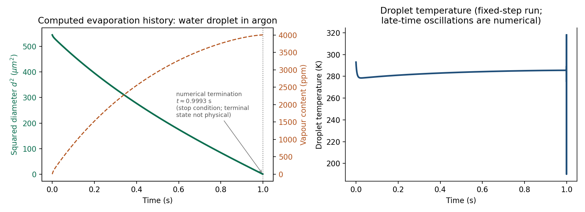

# Spray Evaporation Lab

<div align="center">
  
</div>

<p align="center"><sub>Reference case computed by <code>examples/plot_reference_case.py</code>:
computed evaporation history of a 23 µm water droplet in argon at 1 atm, 293 K
(49,964 accepted states). The run terminates numerically at ≈ 0.9993 s when a
state leaves the physical range — this is a stop-condition event, not a
validated physical lifetime. The terminal state is excluded from the plot and
the stop is marked; visible late-time oscillations are numerical (fixed-step
integration), not measured physics.</sub></p>

**A 0-D single-droplet evaporation model for spray analysis.** This is a
development edition of
[tommasogallingani/droplet_evap_model](https://github.com/tommasogallingani/droplet_evap_model).
It integrates mass and energy balances for one droplet with film-theory
transport (Spalding mass/heat transfer numbers, corrected Sherwood/Nusselt
correlations in the Abramzon–Sirignano tradition, Wilke mixture rules for
viscosity and conductivity, Chapman–Enskog diffusion). It is a 0-D model, not
a 3D atomization or spray-CFD solver.

## Capability overview

| Capability | Details |
| --- | --- |
| Droplet state | diameter, temperature, evaporation rate, lifetime |
| Gas phase | film temperature, vapour content (ppm), relative humidity evolution |
| Transport | Spalding Bm/Bt, Sh = 2 + 0.6·Re^½·Sc^⅓ with correction factors, Wilke φ terms |
| Properties | database-driven (CSV) gas (`Ar`, …) and liquid (`H2O`, …) coefficient fits |
| Configuration | YAML simulation configs (`configs/config.yml`) with pydantic validation |
| Outputs | full state history (dict / pandas), CSV, plots; post-processing helpers |
| Model basis | diffusion-limited evaporation; see the [upstream README](https://github.com/tommasogallingani/droplet_evap_model#readme) for the complete derivation and references |

## Quick start

```bash
python -m venv .venv && .venv/Scripts/activate    # or source .venv/bin/activate
python -m pip install -e .
python -m pytest tests            # 32 tests (24 upstream + 8 new)
python tutorial/tutorial.py       # documented example: water in argon
python examples/plot_reference_case.py   # regenerates the figure above
```

Requires Python ≥ 3.9 with numpy, pandas, matplotlib, seaborn, PyYAML, tqdm,
pydantic (installed automatically). Verified 2026-10-18 on Python 3.13.5.

## Owner changes in this development edition (2026-10-18)

Two robustness defects in `EvapModel.run()` are fixed, with regression tests:

- **Non-finite states now stop the run.** The guard compared
  `d_d == np.nan`, which is never true (NaN compares false against
  everything), so a diverged state kept iterating to `max_iteration`.
  The loop now stops on any non-finite (NaN/inf) or non-positive
  diameter/temperature. Reproduced by the upstream test suite itself, whose
  "wrong property" cases emit invalid-value warnings and previously ran to
  the iteration cap.
- **Complex-value reporting no longer raises.** The warning line subscripted
  the pydantic model (`self.model['modelling']['timestep']`), a latent
  `TypeError` on any complex state; it now uses the local timestep.
- **New tests (`tests/test_robustness.py`, 8 cases).** Guard behavior for
  NaN/inf states and complex-value logging; physical invariants of the
  reference case (overall d² collapse, humidity rise, droplet temperature
  within physical bounds); and a termination-time regression — the run stops
  at 0.99928 s, matching the upstream implementation exactly, confirming the
  fixes leave the numerics untouched. Matching upstream is a numerical
  regression, not independent physical validation. The guard checks diameter
  and temperature only; it does not repair the underlying integration.
- `examples/plot_reference_case.py` renders the README figure from the
  reference case.

## Limitations

- 0-D, single droplet, well-stirred gas at fixed temperature; no spray
  interactions, no atomization, no multicomponent droplets.
- The reported end time is a **numerical termination** (a state left the
  physical range and tripped the stop condition), not a validated physical
  evaporation lifetime. The terminal state itself is non-physical and is
  excluded from plots; the reference YAML also varies humidity and droplet
  temperature, so the d² history is not a demonstration of the classical
  constant-condition d² law.
- Late-time integration with the fixed upstream timestep oscillates
  (evaporation/condensation flutter); those oscillations are numerical, kept
  visible in the results figure, and are not repaired by this edition's guard.
- Liquid density is constant (upstream TODO); several coefficient fits carry
  their own validity ranges; `G` correction factor code retained as upstream.
- Physics verified by invariants and one upstream-matching numerical
  regression, not against new experimental data.

## Upstream source and credits

- Original project: [tommasogallingani/droplet_evap_model](https://github.com/tommasogallingani/droplet_evap_model)
  (MIT license, retained unchanged; see `LICENSE`), also published on PyPI as
  `dropletevapmodel`. Full model derivation and bibliography: upstream README.
- Key model references: Abramzon & Sirignano, *Int. J. Heat Mass Transfer*
  32:1605–18 (1989); Lefebvre & McDonell, *Atomization and Sprays* (CRC, 2017);
  T. Gallingani (2020) — see upstream README reference list.
- This repository preserves the upstream Git history, source authorship,
  tests, CI workflows, and license; the fixes above are the only
  owner-authored changes.
